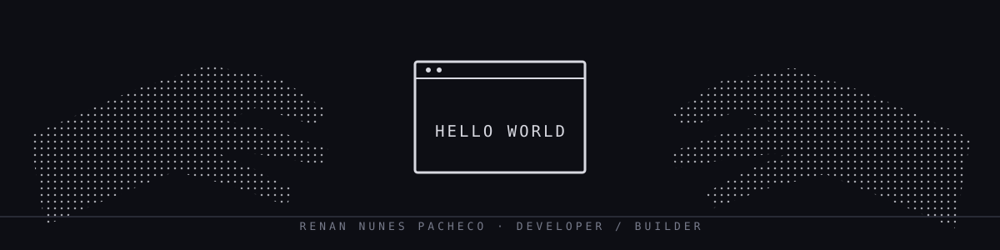

  
   
  <h1>Oi 👋, eu sou Renan</h1>
  
<strong>Entusiasta de tecnologia e IA · Educação Física + Nutrição</strong>

  
Construindo PWAs, automações e ferramentas que conectam tecnologia, treino e cuidado.

  

    <a href="https://github.com/renan2pacheco-source/portfolio">Portfólio</a>
    &nbsp;·&nbsp;
    <a href="https://github.com/renan2pacheco-source/site-prompty">Prompty</a>
  

---

### 🚀 Sobre mim

Estudo **Educação Física e Nutrição** e gosto de transformar ideias em software útil no dia a dia. Tenho explorado **IA, PWAs e automação**, especialmente nas interseções entre tecnologia, treino e cuidado.

### 🧩 Projetos em destaque

| Projeto | Sobre |
| --- | --- |
| [Portfólio](https://github.com/renan2pacheco-source/portfolio) | Projetos pessoais em React e TypeScript. |
| [Prompty](https://github.com/renan2pacheco-source/site-prompty) | Posicionamento, design e automação para marcas. |

### 🛠️ Tecnologias

  

---

  Brasil · construindo com intenção.

