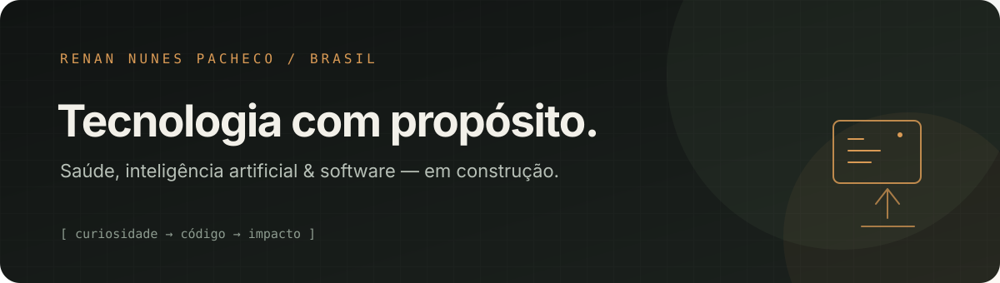

<div align="center">
  
</div>

<div align="center">
  <a href="https://github.com/renan2pacheco-source"></a>
  <a href="https://github.com/renan2pacheco-source/portfolio"></a>
</div>

<br />

## `> olá, eu sou o Renan` 

**Tecnologia, IA e cuidado em movimento.** Sou estudante de Educação Física e Nutrição, entusiasta de tecnologia e criador de ferramentas digitais que aproximam saúde e software.

```text
┌─[renan@omarchy]─[~/ideas]
└──╼ $ transformar ideias em ferramentas úteis_
```

### `// no que estou trabalhando`

- **[Fokus](https://github.com/renan2pacheco-source/fokus-app)** — experiência digital para treino, dieta e cardio, pensada para acompanhamento próximo.
- **[Portfólio](https://github.com/renan2pacheco-source/portfolio)** — meu espaço na web: projetos, experimentos e caminhos em construção.
- **[Prompty](https://github.com/renan2pacheco-source/site-prompty)** — posicionamento, design e automação para marcas.

### `// meu universo`

`IA aplicada` · `PWAs` · `automação` · `saúde & performance` · `Linux / Omarchy`

### `// fora do terminal`

Estudando como movimento, alimentação e tecnologia podem se complementar — e construindo coisas no caminho. 🇧🇷

<div align="center">
  <sub><code>feito com curiosidade, café e um terminal bem configurado</code></sub>
</div>
